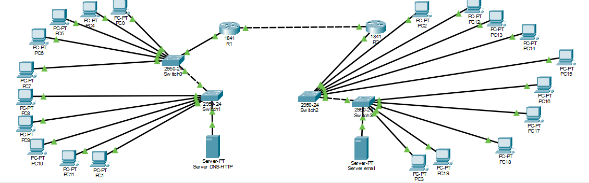
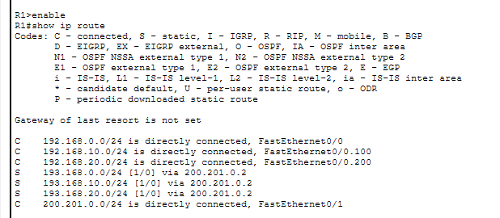
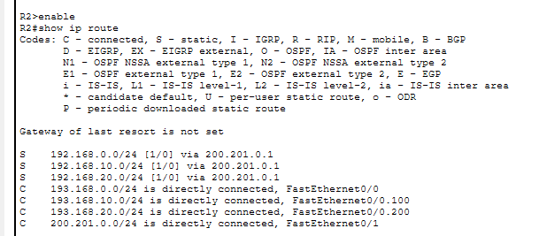
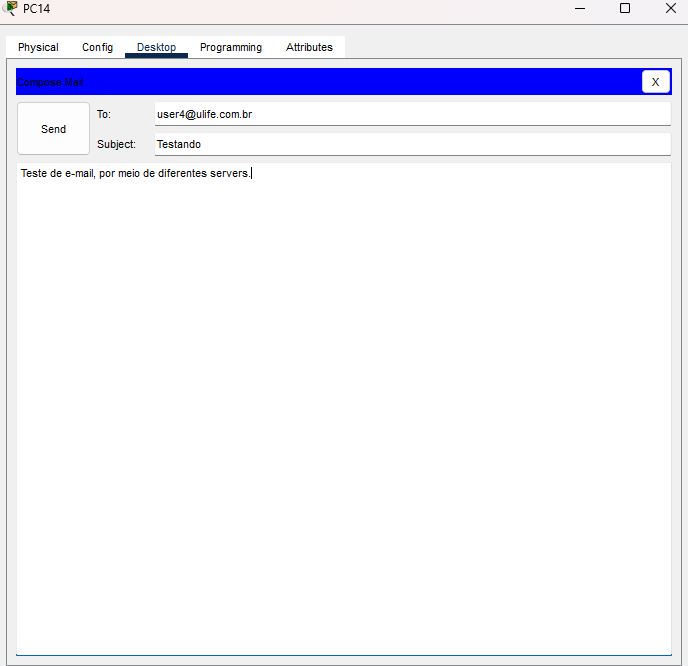
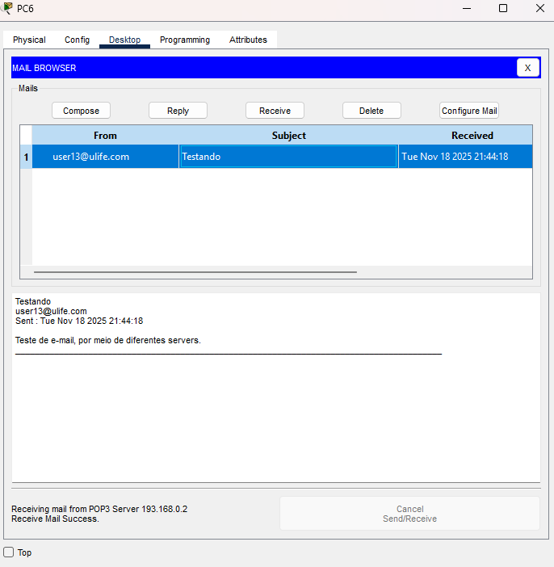
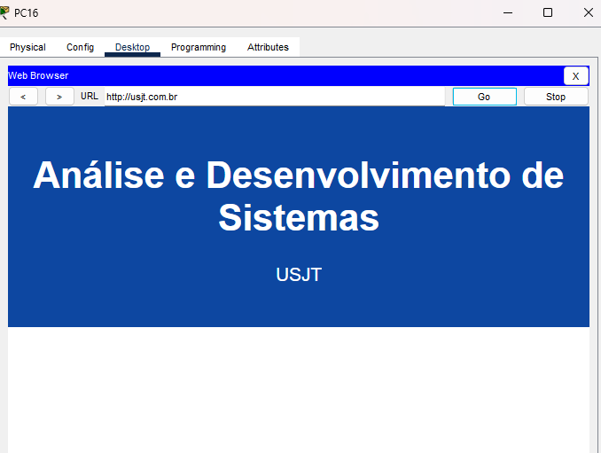
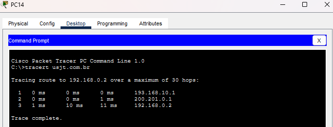

# 🌐 Rede com Duas Filiais: Roteamento, DHCP, DNS, HTTP e E-mail

Projeto de infraestrutura de redes simulado no **Cisco Packet Tracer**. Duas filiais são interligadas por roteadores Cisco 1841 com **rotas estáticas**, e os serviços de **DHCP**, **DNS**, **servidor web (HTTP)** e **servidor de e-mail (SMTP/POP3)** ficam acessíveis para todos os PCs da rede, nas duas filiais.


---

## 🎯 Objetivo

Montar uma rede corporativa com duas filiais e fazer com que serviços hospedados em uma filial sejam usados normalmente pela outra, passando pelo roteamento entre as duas.

- Um PC da Filial B abre o site hospedado na Filial A **pelo nome de domínio**.
- Usuários das duas filiais **trocam e-mails** entre si.
- Todos os PCs recebem configuração de rede **automaticamente**.

---

## 🗺️ Topologia



| Item | Quantidade | Detalhes |
|---|---|---|
| Roteadores | 2 | Cisco 1841 (R1 e R2) |
| Switches | 4 | Cisco 2960-24 (Switch0 e Switch1 na Filial A, Switch2 e Switch3 na Filial B) |
| PCs | 20 | 10 por filial |
| Servidores | 2 | Servidor DNS-HTTP (Filial A) e Servidor de e-mail (Filial B) |

### Endereçamento

| Rede | Local | Interface |
|---|---|---|
| `192.168.0.0/24` | Filial A (servidores) | R1 `Fa0/0` |
| `192.168.10.0/24` | Filial A | R1 `Fa0/0.100` |
| `192.168.20.0/24` | Filial A | R1 `Fa0/0.200` |
| `193.168.0.0/24` | Filial B (servidores) | R2 `Fa0/0` |
| `193.168.10.0/24` | Filial B | R2 `Fa0/0.100` |
| `193.168.20.0/24` | Filial B | R2 `Fa0/0.200` |
| `200.201.0.0/24` | Link entre roteadores | R1 `200.201.0.1` ↔ R2 `200.201.0.2` (`Fa0/1`) |

| Servidor | IP | Serviços |
|---|---|---|
| Servidor DNS-HTTP | `192.168.0.2` | DNS, HTTP |
| Servidor de e-mail | `193.168.0.2` | SMTP, POP3 |

---

## ⚙️ O que foi configurado

### 1. Roteamento estático entre as filiais

Cada roteador conhece as redes da outra filial por meio de rotas estáticas, tendo o roteador vizinho como próximo salto.

```
! R1: rotas para a Filial B
ip route 193.168.0.0  255.255.255.0 200.201.0.2
ip route 193.168.10.0 255.255.255.0 200.201.0.2
ip route 193.168.20.0 255.255.255.0 200.201.0.2

! R2: rotas para a Filial A
ip route 192.168.0.0  255.255.255.0 200.201.0.1
ip route 192.168.10.0 255.255.255.0 200.201.0.1
ip route 192.168.20.0 255.255.255.0 200.201.0.1
```

As redes de cada filial usam **subinterfaces** (`Fa0/0.100` e `Fa0/0.200`) em cada roteador, separando o tráfego em redes diferentes.

### 2. DHCP

Os PCs das duas filiais recebem **IP, máscara, gateway e servidor DNS** automaticamente.

<!-- ✏️ COMPLETAR: pools DHCP (nome, rede, gateway, DNS, endereços excluídos) e, se quiser, adicionar um print do "show ip dhcp binding" -->

### 3. DNS e servidor web (HTTP)

- O servidor DNS resolve o domínio **`usjt.com.br`** para `192.168.0.2`.
- O servidor HTTP hospeda uma página personalizada, acessada pelos PCs das duas filiais.

### 4. Servidor de e-mail (SMTP/POP3)

- Domínio **`ulife.com.br`** configurado no servidor de e-mail (`193.168.0.2`).
- Contas de usuário criadas para os PCs de ambas as filiais.
- Clientes de e-mail configurados com **SMTP** (envio) e **POP3** (recebimento).

---

## ✅ Testes e resultados

### Roteamento: tabelas de rotas

As rotas estáticas (`S`) aparecem nos dois roteadores, junto com as redes diretamente conectadas (`C`).

| R1 | R2 |
|---|---|
|  |  |

### E-mail entre filiais

O **PC14** (Filial B) envia uma mensagem e o **PC6** (Filial A) recebe pelo servidor POP3 (`193.168.0.2`), com a confirmação *Receive Mail Success*.

| Envio (PC14) | Recebimento (PC6) |
|---|---|
|  |  |

### Acesso ao site pelo nome de domínio

O **PC16** (Filial B) abre `http://usjt.com.br`, hospedado no servidor da Filial A.



### Caminho dos pacotes (`tracert`)

O `tracert usjt.com.br` a partir do **PC14** mostra o caminho completo: gateway da Filial B (R2) → R1 → servidor DNS-HTTP.



| Salto | Endereço | Dispositivo |
|---|---|---|
| 1 | `193.168.10.1` | R2 (gateway do PC14) |
| 2 | `200.201.0.1` | R1 |
| 3 | `192.168.0.2` | Servidor DNS-HTTP |

---

## 🚀 Como reproduzir

1. Instale o **Cisco Packet Tracer** (<!-- ✏️ COMPLETAR: versão usada -->).
2. Baixe o arquivo [`projeto/Projeto_Roteador_com_DHCP_e_EMAIL.pkt`](projeto/Projeto_Roteador_com_DHCP_e_EMAIL.pkt) e abra no Packet Tracer.
3. Teste a rede:
   - Em um PC da Filial B: **Desktop → Web Browser** → `http://usjt.com.br`
   - **Desktop → Command Prompt** → `tracert usjt.com.br`
   - **Desktop → Email** → enviar e receber mensagens entre PCs de filiais diferentes

---

## 📚 Aprendizados

- Configuração de **roteamento estático** e leitura de tabelas de rotas (`show ip route`).
- Uso de **subinterfaces** no roteador para dividir a rede em segmentos.
- Funcionamento do **DHCP** na entrega automática de endereçamento.
- Papel do **DNS** na resolução de nomes e como isso aparece no acesso ao site.
- Fluxo de e-mail com **SMTP** (envio) e **POP3** (recebimento).
- Diagnóstico de conectividade com `ping` e `tracert`.

---

## 📁 Estrutura do repositório

```
.
├── README.md
├── projeto/
│   └── Projeto_Roteador_com_DHCP_e_EMAIL.pkt
├── configs/
│   ├── R1-running-config.txt
│   └── R2-running-config.txt
└── imagens/
```

---

## 👤 Autor

**Gustavo Rodrigues Freitas Ricarte**

Estudante de Análise e Desenvolvimento de Sistemas (USJT) | Suporte e Infraestrutura de TI

[GitHub](https://github.com/guricartee) · [LinkedIn](www.linkedin.com/in/guricarte)
